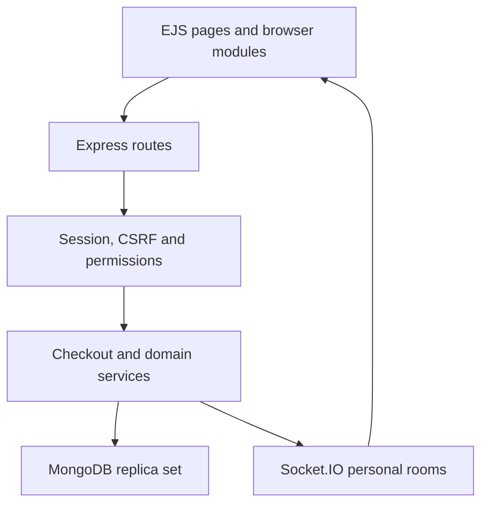

# NEXORA Commerce

**Good things. Great everydays.**

A responsive, server-rendered e-commerce college project built with **EJS, Node.js, Express, MongoDB, Socket.IO, Three.js, GSAP and Tailwind CSS**. Designed for a local ₹0 demonstration, with original product illustrations and no required external commercial service.

> **DEMO PAYMENT — NO REAL MONEY WILL BE CHARGED.** Products, orders, revenue, delivery and refunds are simulated. Never enter real payment credentials. No payment gateway, UPI PIN, card number or CVV is collected.

## Current implementation

This is the first substantial implementation, not a claim that every requirement in the master prompt is finished. See [feature status](docs/FEATURE_STATUS.md) and [actual validation results](docs/TESTING_REPORT.md).

- Responsive storefront, category browsing, pagination, search/autocomplete, filters and sorting.
- Original local SVG catalog assets, light/dark theme, Three.js headphone hero with static fallback, lazy GSAP/Chart.js modules.
- Customer and seller registration; MongoDB-backed sessions; bcrypt passwords; CSRF validation; rate limits; server-side roles and seller ownership.
- Saved addresses, persistent carts and wishlists, coupons, server-priced simulated checkout, order history, item fulfillment, cancellation, return/refund simulation and verified-purchase reviews.
- Atomic transactional checkout, unique idempotency keys, conditional stock decrements and transactional cancellation restoration.
- Seller product management, content-validated image uploads, approval workflow, admin moderation and protected super-admin role assignment.
- Persistent notifications and session-authenticated Socket.IO connections with server-selected personal rooms.
- 32 demo products, 8 categories, 2 approved sellers, 7 seeded orders and a transparently labeled sample review backed by a delivered demo order.
- Development-only email preview, bootstrap, environment setup, build and tests.

## Stack and architecture

| Layer | Implementation |
|---|---|
| Runtime | Node.js 24 LTS; npm |
| Web | Express 5; EJS; HTML/CSS; browser ES modules |
| UI build | Vite; Tailwind CSS 4; Lucide |
| Visuals | Three.js; GSAP; Chart.js |
| Persistence | MongoDB replica set; Mongoose; connect-mongo |
| Authentication | express-session; bcryptjs; CSRF tokens |
| Validation and security | Zod; Helmet CSP; express-rate-limit; Multer + Sharp |
| Live updates | Socket.IO with session authentication |
| Tests | Vitest; Supertest; disposable MongoDB replica set |



## Install on Windows / WSL2

Use **Node.js 24**, npm, **MongoDB Community Server** and **mongosh**. Docker is not required. Install MongoDB inside the same environment where you run these commands; the examples below assume WSL2 Ubuntu. Do not expose this demo database or application to the public internet.

```bash
git clone https://github.com/Sung-Barsan/E-Commerce.git
cd E-Commerce
npm ci
npm run setup
npm run build
```

`npm run setup` creates `.env` with a cryptographically random session secret and leaves existing `.env` files unchanged. `.env` is ignored by Git.

### Start a local MongoDB replica set

Transactions require a replica set, including for a single-machine demonstration. A standalone `mongod` is insufficient. If a MongoDB service already occupies port 27017, stop that service or configure it as a replica set before proceeding; do not start two processes on the same port or data directory.

In terminal 1:

```bash
mkdir -p "$PWD/.local-mongo"
mongod --dbpath "$PWD/.local-mongo" --replSet rs0 --bind_ip 127.0.0.1 --port 27017
```

In terminal 2, initialize **once for this data directory**:

```bash
mongosh "mongodb://127.0.0.1:27017" --eval 'rs.initiate({_id:"rs0",members:[{_id:0,host:"127.0.0.1:27017"}]})'
```

Wait for a primary; verify:

```bash
mongosh "mongodb://127.0.0.1:27017/?replicaSet=rs0" --eval 'db.hello().isWritablePrimary'
```

When it prints `true`:

```bash
npm run seed
npm run dev
```

Open **http://localhost:3000**. Keep terminal 1 running. `npm start` runs without Node's file watcher. Re-run `npm run build` after changing browser JavaScript or CSS.

The seed refuses to modify a nonempty user database. It never deletes your existing data. To repeat a fresh demonstration, choose a new local database name in `MONGODB_URI`.

### Optional disposable demonstration

```bash
npm run build
npm run demo:temporary
```

This uses `mongodb-memory-server` to download and start a **real**, temporary, single-node MongoDB replica set, then seeds it. It does not connect to `.env`'s database. **All its data disappears on exit.** Initial download requires internet; local resource restrictions can prevent the MongoDB binary from starting. Use the persistent local setup above for your college project work. No Docker, account or payment is required.

## Demo accounts

All seeded accounts use password **`NexoraDemo123!`**. They are development fixtures only; the seed and temporary demo refuse production mode.

| Role | Email | Dashboard |
|---|---|---|
| Customer | `customer@nexora.test` | `/account` |
| Seller 1 | `seller@nexora.test` | `/seller/dashboard` |
| Seller 2 | `seller2@nexora.test` | `/seller/dashboard` |
| Admin | `admin@nexora.test` | `/admin/dashboard` |
| Super admin | `superadmin@nexora.test` | `/super-admin/dashboard` |

Guests browse without accounts. Public registration accepts only customer or seller; new sellers need approval. Admins cannot assign roles. Super admins can assign customer/seller/admin to eligible non-super-admin accounts. Every super-admin account is immutable through web role/suspension controls, protecting the last super admin. Sellers with historical products retain their seller role.

For an empty database without seed accounts, set `BOOTSTRAP_EMAIL` and `BOOTSTRAP_PASSWORD` in your local shell, then run `npm run bootstrap`. This development-only command refuses to run if any super admin exists. It never overwrites existing credentials.

## Demo walkthrough

1. Sign in as the customer; browse products, save one, and add it to your bag.
2. Optionally apply `NEXORA10`: 10% off, minimum ₹1,000, maximum ₹1,000 discount, once per customer.
3. Select the seeded fictional address at checkout. Choose Demo Card, Demo UPI or Demo COD and an outcome.
4. A success creates one order; failed/cancelled attempts leave the bag and stock unchanged. COD records payment as pending until all items are delivered.
5. Open a seller account in a separate browser profile to view its own order items. Advance Confirmed → Processing → Shipped → Out for Delivery → Delivered.
6. The customer's notifications persist in MongoDB and arrive live when connected. Review a delivered purchase or request a return.
7. Register a new seller; approve it as admin, create a listing as that seller, then approve the listing as admin.
8. Use the super-admin dashboard to inspect protected elevated role changes and the audit trail.

Order cancellation is allowed only before **any** item has shipped. Cancellation restores stock once. Coupons remain consumed after cancellation. Return refunds are a separate simulated workflow; returned stock is not automatically restocked.

## Local email simulator

Registration and password reset create development-only messages. They are not public pages or production logs. The local machine operator can inspect the last unexpired messages:

```bash
npm run mail -- customer@nexora.test
```

Open the generated link in the browser and submit its form. Verification requires signing into the matching account. Reset tokens expire in 30 minutes and are one-time; changing/resetting a password increments a session version and invalidates other sessions. The temporary demo's database is separate, so use the persistent setup for this CLI email walkthrough.

## Commands

| Command | Purpose |
|---|---|
| `npm run setup` | Create local configuration and random secret |
| `npm run build` | Bundle browser code, local dependencies and Tailwind CSS |
| `npm run dev` | Watch and run the persistent local app |
| `npm start` | Run the app without a watcher |
| `npm run seed` | Seed an empty development database |
| `npm run demo:temporary` | Disposable seeded replica-set demo |
| `npm run mail -- EMAIL` | Inspect development email simulator |
| `npm run bootstrap` | Development-only initial super admin |
| `npm test` | Unit, EJS, integration, security and concurrency tests |
| `npm run lint` | JavaScript and EJS syntax validation (not a style linter) |

Tests always provision their own disposable database; they do not use your `.env` database. The first integration run downloads MongoDB. `MONGOMS_VERSION` can select a compatible test binary. To run checks that do not require a database:

```bash
npx vitest run tests/policies.test.js tests/templates.test.js
```

GitHub Actions runs install, syntax validation, build and the full test suite on pushes and pull requests. Consult the workflow result for verification; merely adding a workflow is not a passing test result.

## Environment

| Variable | Meaning |
|---|---|
| `NODE_ENV` | `development`, `test` or `production` |
| `PORT` | Default `3000` |
| `MONGODB_URI` | Local replica-set URL; default sample uses database `nexora` |
| `SESSION_SECRET` | Random secret, at least 32 characters; setup generates it |
| `APP_BASE_URL` | Default `http://localhost:3000`; socket origin must match |
| `DEMO_MODE` | Must remain `true`; real payment mode does not exist |
| `DEMO_EMAIL_MODE` | Reserved documentation flag; actual email simulation is gated by development mode |
| `DEFAULT_CURRENCY` | Reserved documentation flag; this release is INR-only |

The server binds to `127.0.0.1`. Production mode requires HTTPS cookies and is not a complete deployment configuration. Do not assume this academic app has been audited for public commercial use.

## Security and limitations

See [security overview](docs/SECURITY_OVERVIEW.md). EJS escapes user content; prices are integer paise; inputs are allowlisted; mutations require CSRF; uploaded images are decoded and re-encoded as WebP; sessions and sockets use server-verified identities. The local email CLI assumes the machine operator is trusted. No payment or email service is contacted.

Not yet implemented: configurable role/permission editor, platform settings and banner CRUD, variant-level SKU/stock, a GLB product viewer, full email event coverage, a notification dropdown, back-in-stock watcher targeting, complete dashboard analytics, and a guided JavaScript checkout stepper. Checkout currently uses clearly numbered sections on one server-rendered page. See the complete feature status before presenting scope to an examiner.

Original SVG assets are authored in this repository; no external product photos or branded commercial assets are bundled. Third-party package licenses remain their respective authors' terms. `UNLICENSED` means the project itself has not yet been assigned an open-source redistribution license by its owner.

## Documentation and screenshots

Academic documents are in [`docs/`](docs/). To capture screenshots after starting and seeding the app, use desktop and phone viewport sizes for the homepage, product detail, bag, checkout and each role dashboard. Avoid displaying secrets, email reset links, or real personal data.
