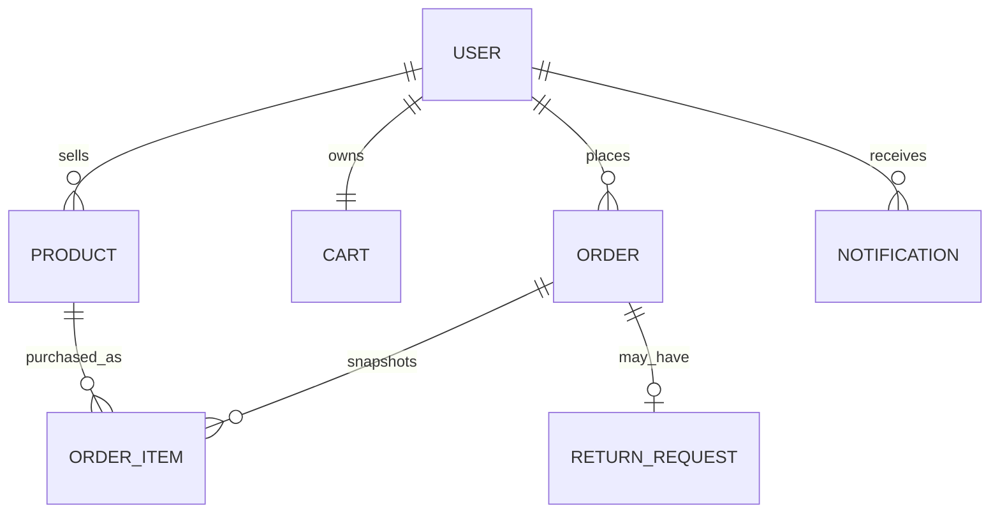

# Database schema

Definitions live in `src/models/index.js`. Money is stored as integer paise; INR formatting happens at render time.

| Collection | Purpose and constraints |
|---|---|
| users | Unique lowercased email, excluded password hash, fixed role enum, seller approval, suspension, sessionVersion, embedded addresses |
| categories | Unique name and slug |
| products | Unique SKU/slug, seller ref, category name, price/stock validation, moderation state, images, rating aggregates |
| carts | Unique user; product/quantity lines; coupon code |
| wishlists | Unique user; addToSet product references |
| orders | Unique number and compound user/key, purchase-time price/name/image snapshots, seller lines, per-item fulfillment, address snapshot, timeline |
| demopayments | Unique compound user/key, method, result, total and optional order reference |
| coupons | Unique code, percentage, integer cap/minimum, expiry, maxUses, use count and consumed user references |
| reviews | Unique user/product pair; rating, text, moderation state; delivered purchase checked before creation |
| notifications | Recipient, title/message, related relative URL, read state; indexed by recipient/date |
| auditlogs | Actor, action, target and timestamp |
| returnrequests | Unique order, customer, reason and requested/approved/rejected/refunded state |
| tokens | Unique SHA-256 token hash, user, purpose and expiry with TTL index |
| simulatedemails | Development-only token links for local operator CLI; expiry with TTL |
| sessions | connect-mongo session persistence and expiry |

ORDER_ITEM and addresses are embedded structures, not independent collections. Category references are names in this release; category rename is not exposed. Roles/permissions are fixed source policies rather than dynamic collections. Inventory reservations are unnecessary because each successful simulated checkout is finalized in one transaction; no real asynchronous payment exists.
