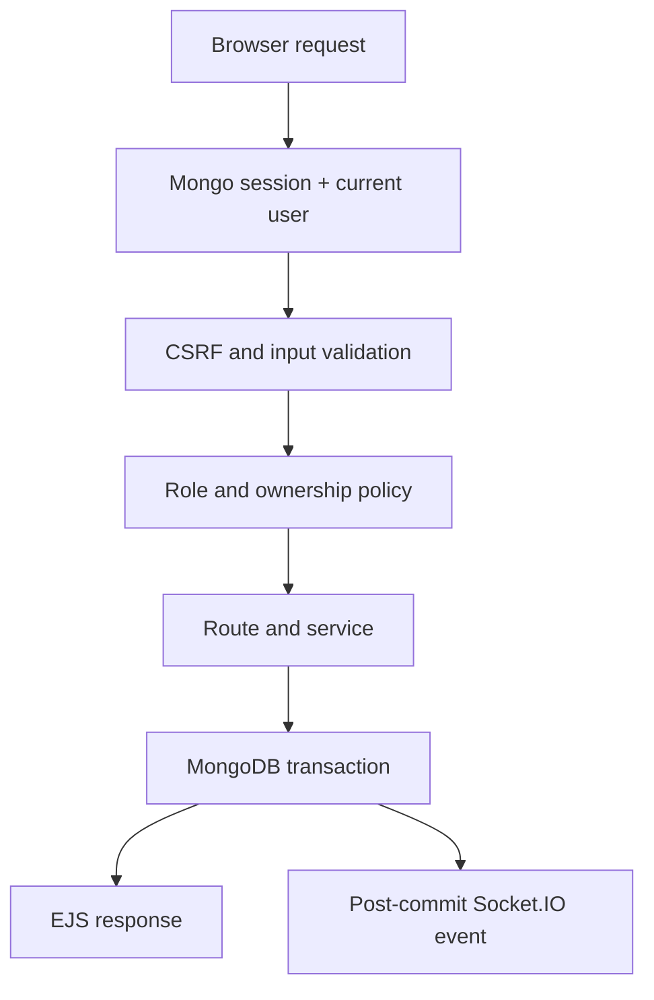

# System architecture

Express serves EJS pages and local built browser assets. Middleware loads the current user from MongoDB on every request; the session stores an identifier and session version, not a trusted role. Protected controllers apply permissions and ownership constraints. Services own transaction-heavy checkout/cancellation logic. Mongoose schemas validate documents and indexes enforce uniqueness.

## Checkout

A customer submits a UUID, saved address, method and chosen simulated outcome. Backend reloads the cart, seller eligibility, product prices, stock and coupon. Failed/cancelled attempts record their outcome without reserving or decrementing inventory. Successful attempts commit stock, order snapshots, payment, coupon consumption, cart clearing and persistent notifications together. Atomic stock predicates and transaction conflicts prevent both concurrent transactions from consuming the same last unit. Unique customer/key indexes prevent duplicate finalization. Events emit only after commit.

## Authentication

Login verifies bcrypt, rotates the session ID, and records user ID/version. Request middleware checks suspension and version against the current document. Password changes, role changes and suspension increment sessionVersion. Logout destroys the session and disconnects that session's sockets. Socket handshakes load the same session and user record; the server selects rooms and exposes no client room-join operation.

## Data flow limitations

Socket.IO broadcasts are best-effort after commit, not a durable message broker. Notifications remain queryable after reconnect. A process crash between commit and emission can lose the instantaneous event but not the database notification. Fixed policies intentionally avoid an untested dynamic permission engine. See SECURITY_OVERVIEW.md and FEATURE_STATUS.md.
